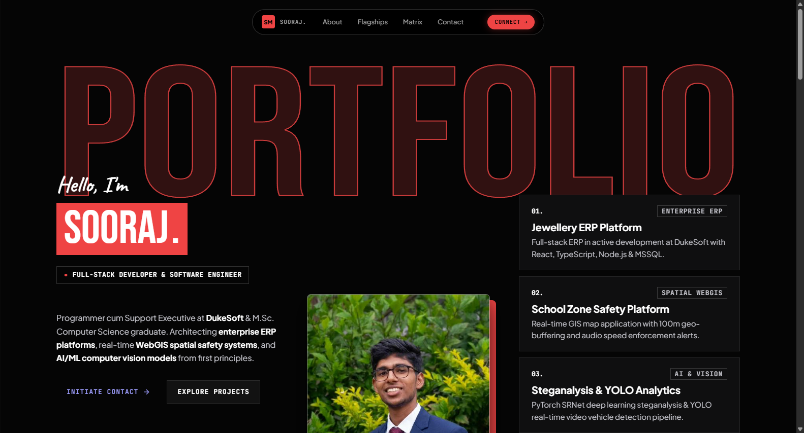
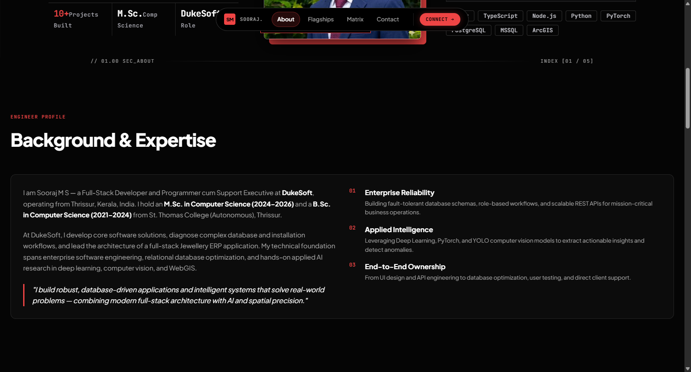
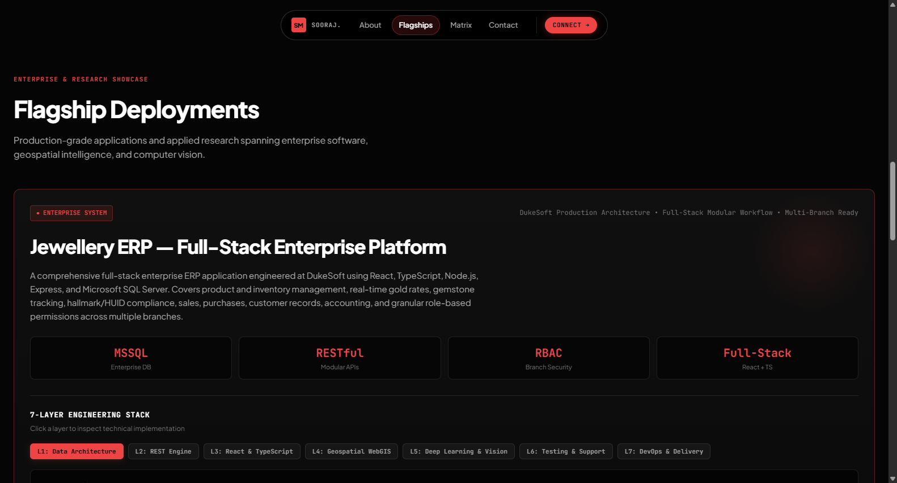

# Agentic-Portfolio

<p align="center">
  
  
  
  
  
</p>

A modern, high-performance personal portfolio built for **Sooraj M S** (Full-Stack Developer & Software Engineer) featuring a high-contrast Noir & Crimson Op-Art aesthetic, an interactive 7-layer architecture inspector, dynamic bento filtering, HiDPI Aurora canvas graphics, and an elastic cursor swarm rebuild simulation.

---

## 📸 Hero Preview

<p align="center">
  
</p>

## 🖼️ UI Snapshot Gallery

<p align="center">
  
  
</p>

---

## ✨ Features

- ⚡ **Zero-Dependency Core** - Ultra-fast vanilla ES6+ JavaScript, modular CSS custom properties, and native CSS Grid/Flexbox.
- 🏗️ **7-Layer Architecture Inspector** - Interactive stack explorer mapping L1 Data Architecture through L7 DevOps & Delivery.
- 🍱 **Systems Matrix (Bento Grid)** - Live category filtering (`All`, `Full-Stack`, `AI / ML`, `Tools`) with direct GitHub repository links.
- 🤖 **Elastic Swarm Rebuild Engine** - Multi-agent autonomous cursor kinematics simulation with keyboard controls (`ESC` to toggle).
- 📋 **1-Click Direct Email Copy** - Instant clipboard integration with floating animated toast notification.
- 🌐 **Responsive & SEO Optimized** - Full OpenGraph social cards, JSON-LD structured data, and fluid mobile viewports.

---

## 🛠️ Tech Stack

- **Core**: Vanilla JavaScript (ES6+), HTML5, CSS3 Variables
- **Graphics**: HTML5 HiDPI Canvas (Aurora & Particle Simulation)
- **Deployment**: Netlify

---

## 🚀 Quick Start

### 1. Clone the repository
```bash
git clone https://github.com/soorajstudio/Agentic-Portfolio.git
cd Agentic-Portfolio
```

### 2. Run locally
```bash
# Using Python
python -m http.server 8080

# Or using Node
npx serve .
```

Open [http://localhost:8080](http://localhost:8080) in your browser.

---

## 📄 License

This project is licensed under the MIT License — see the [LICENSE](LICENSE) file for details.

Developed with ❤️ by [Sooraj Studio](https://github.com/soorajstudio).
